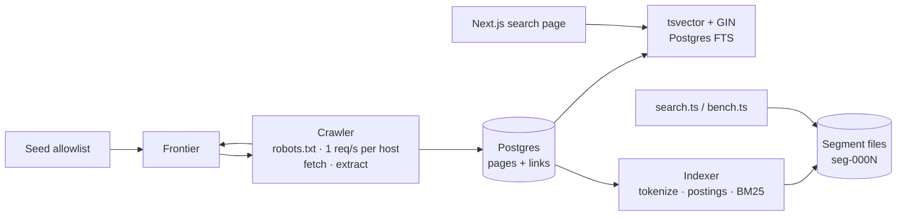

# Provenance

> A search engine for engineering knowledge, built from scratch, down to the inverted index. It shows where every answer comes from.

**Status:** early, honest, and under construction. 🚧 Works today:
- a **polite crawler** (20 allowlisted engineering sites, robots.txt, 1 request/second per host)
- a **Postgres page store** with full-text search and a **Next.js search page**
- **my own inverted index**: a tokenizer, BM25 ranking, write-once segment files on disk, merging, and a benchmark against Postgres

## Demo


## Why build a search engine from scratch?

Because `SELECT ... ORDER BY ts_rank` is a great answer and a terrible teacher. Postgres can search text very well, and that's exactly why it's the baseline here: every piece I build has to beat it, match it, or explain why it doesn't.

The end goal is **research mode**: an agent that plans searches, reads pages, compares sources and answers with citations. Before an agent can cite a page, something has to find it. That part comes first.

## How it works



**Ingest**
- **Frontier:** a queue of URLs with a seen set, so nothing is fetched twice, plus caps per host and in total.
- **Crawler:** checks robots.txt, waits its turn per host, fetches, and extracts title, text and links. New links on allowlisted hosts go back into the frontier.
- **Page store:** each page and its links are saved in one transaction. A re-crawl updates the page instead of duplicating it.

**My index** (`indexer/`)
- **Tokenizer:** lowercase, split on anything that isn't a letter or digit, strip plurals (Porter step 1a). Words of 3 letters or fewer are left alone, after it briefly turned `js` into `j`.
- **Inverted index:** `term → [{ docId, tf }]` plus page lengths. Postings stay sorted by page id, so an AND query is a two-pointer walk.
- **BM25:** Lucene's idf, `k1 = 1.2`, `b = 0.75`. Rare words count more, repeats saturate, and long pages don't win just by being long.
- **Segments:** the index is flushed to a write-once file with sorted terms (SSTable-style). New pages go into a **new** segment, never into an old file. Search reads all segments as one index, so BM25's statistics stay global.
- **Merging:** two segments become one, and the new file is written *before* the old ones are deleted, so a crash leaves duplicates, never data loss. The merge policy combines the **two newest** files, so file order keeps matching page-id order. (The obvious version, "merge the two oldest and call it newest + 1", quietly puts old ids in a newer file and un-sorts every postings list.)

**Search page:** Postgres turns each page into a `tsvector` (title weighted above body), a GIN index finds matches, and `ts_rank` orders them. Results stream in with the matching words highlighted. *(Switching it to my index is next.)*

More detail: [Architecture](docs/ARCHITECTURE.md).

## Benchmark: my index vs Postgres FTS

`bun indexer/src/bench.ts`: 10 queries (1-word, 2-word and long ones), each run 20 times after a warm-up; the median is reported. **Overlap** = how many of my top 10 pages Postgres also returns.

| query | mine (ms) | pg AND (ms) | pg OR (ms) | overlap AND | overlap OR |
|---|---:|---:|---:|---:|---:|
| redis | 0.008 | 0.781 | 0.886 | 3/3 | 3/3 |
| sqlite | 0.010 | 0.889 | 0.927 | 8/10 | 8/10 |
| kubernetes | 0.005 | 0.859 | 0.853 | 3/3 | 3/3 |
| docker compose | 0.004 | 0.822 | 0.907 | 2/2 | 4/4 |
| react state | 0.011 | 0.950 | 0.928 | 10/10 | 10/10 |
| typescript generics | 0.007 | 0.868 | 0.975 | 6/6 | 9/10 |
| rate limiting | 0.002 | 0.799 | 0.868 | 1/1 | 4/4 |
| how to write a dockerfile | 0.010 | 0.716 | 0.856 | 2/2 | 9/10 |
| why is my postgres query slow | 0.009 | 0.747 | 0.846 | n/a | 7/10 |
| how do distributed systems fail | 0.011 | 0.733 | 0.858 | 2/2 | 8/10 |

**What this says:**
- **Same pages, mostly.** Against Postgres in OR mode (the same rules as mine), the top 10s share **65 of 74 pages (~88%)**. The gaps come from known differences: Postgres drops stop words and stems `limiting` → `limit`; mine keeps stop words and only strips plurals.
- **Postgres in AND mode** (what the search page uses) needs *every* word on the page. `why is my postgres query slow` finds nothing, which is a strong opinion for a search box.
- **Faster, with an asterisk the size of a container.** My index is a `Map` in the same process; every Postgres query is a network round trip to Docker. `bench.ts` also times a do-nothing `SELECT 1`, so you can see how much of Postgres's ~0.8 ms is just the trip. This compares *architectures* as much as ranking code, and that's the honest way to read it.
- **Stop words cost something.** Long queries are among my slowest (~0.01 ms vs 0.002–0.005 for most short ones) because `how`, `to` and `is` sit on almost every page, so their postings get walked in full. BM25 gives them almost no weight, but walking those postings still costs time.
- **Small print:** 53 pages, one laptop, and differences under ~0.2 ms are noise (one-word queries are identical in AND and OR mode, and still came out up to 0.1 ms apart). Overlap counts shared pages, not their order. Ranking quality gets a real evaluation (labeled queries, NDCG) later.

## Known limitations
- **Two tokenizers, one results page.** My BM25 index picks and orders the pages, but the snippet under each title still comes from Postgres `ts_headline`. The two read a query differently: BM25 matches *any* word and only strips plurals, while Postgres's query needs *every* word and uses its English stemmer. So the order is right, but some snippets have no highlighted words. The fix is a snippet generator built on my own tokenizer, planned alongside the evaluation work.

## Things that bit me (so far)

- **Postgres `BIGINT` arrives as a string in JavaScript**, because JS numbers are exact only up to 2⁵³. String ids sort as `"10" < "9"`, which would have broken every sorted postings list. They're converted to numbers right at the database boundary.
- **`console.log((score.toFixed(2), docId))`** printed only the id. Extra parentheses turn the comma into the *comma operator*, which evaluates both and keeps only the last.
- **The plural stemmer turned `js` into `j`, `is` into `i` and `was` into `wa`.** Real Porter checks how much of the word is left; mine now leaves short words alone.
- **`Disallow: /*` meant allow-all.** My robots.txt parser does prefix matching, not wildcards, so the "block everything" default for dead hosts blocked nothing. Now it's `Disallow: /`.
- **`regex /|s+/` instead of `/\s+/`:** one missing backslash, and the benchmark's OR mode searched for single letters. Found it before the numbers got published, which is the best time.

## Tech
TypeScript · Bun · Next.js · PostgreSQL · Docker. No search library, no ORM, no HTTP client: built-in `fetch`, `HTMLRewriter` and Bun's `sql`. Planned: pgvector · Terraform · AWS.

## Roadmap
- [x] Polite crawler: allowlist, robots.txt, per-host rate limit, URL dedup
- [x] Page store in Postgres with full-text search and a search page
- [x] Own inverted index: tokenizer, BM25, segment files, merge policy
- [x] Benchmark against Postgres FTS (speed + result overlap)
- [ ] Search page on my own index
- [ ] Live deployment with a bigger crawl
- [ ] Evaluation set (labeled queries, NDCG/recall), then hybrid search: keywords + embeddings
- [ ] Research mode: an agent that answers with citations, checks them, and treats crawled pages as untrusted input
- [ ] Later: distributed crawling (Terraform), near-duplicate detection, a reranker, binary + sharded segments, freshness

## Run it locally

Requirements: [Bun](https://bun.sh) 1.4+ and [Docker](https://www.docker.com/). Run everything from the repo root so `.env` loads.

```bash
git clone https://github.com/Rza-O/provenance.git && cd provenance
bun install

cp .env.example .env                  # set POSTGRES_PASSWORD and DATABASE_URL
docker compose up -d                  # Postgres 18 on localhost:5432
docker compose exec -T db psql -U provenance -d provenance < db/schema.sql

bun crawler/src/index.ts              # crawl the allowlist into Postgres
```

My index:

```bash
bun indexer/src/index.ts              # index new pages into data/segments (merges as needed)
bun indexer/src/search.ts docker compose   # top results with titles + timing
bun indexer/src/bench.ts              # the benchmark table above
bun test                              # crawler + indexer tests
```

The search page (Postgres FTS for now):

```bash
echo "DATABASE_URL=postgres://provenance:<password>@localhost:5432/provenance" > web/.env.local
cd web && bun run dev                 # http://localhost:3000
```

## Crawling policy
Provenance only crawls an allowlist of public engineering sites, follows robots.txt, rate-limits every domain, and identifies itself as `ProvenanceBot`. If your site is on the list and you'd rather it wasn't, open an issue and it's gone.
