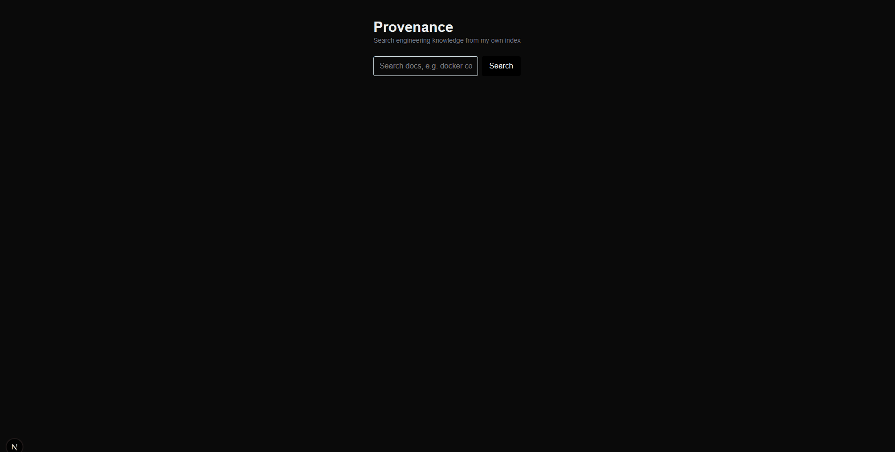
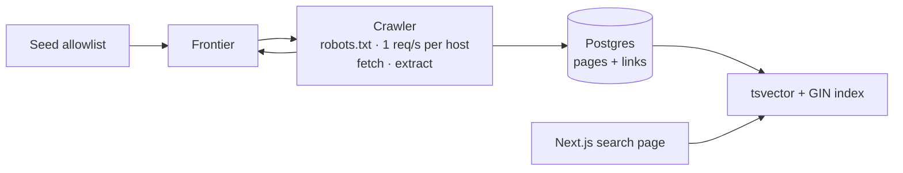

# Provenance

> A research search engine for engineering knowledge, built from scratch. It shows where every answer comes from.

**Status:** early and actively built. Works today: a polite crawler for 20 allowlisted engineering sites, a Postgres page store, and a Next.js search page with ranked full-text results. 🚧

## Demo



## What it does
- **Search mode:** type a query, get ranked pages from Provenance's own index, with the matching words highlighted.
- **Research mode:** an agent plans searches, reads pages, compares sources, and writes an answer with citations. *(planned)*

## How it works



- **Frontier:** a queue of URLs to visit, with a seen set so no page is fetched twice, plus caps per host and in total.
- **Crawler:** checks robots.txt, waits its turn per host, fetches the page, and extracts the title, text and links. New links on allowlisted hosts go back into the frontier.
- **Page store:** each page and its outgoing links are saved in one transaction. A re-crawl updates the page instead of duplicating it.
- **Search:** Postgres turns each page into a `tsvector` (title weighted above body), a GIN index finds matches, and `ts_rank` orders them. The page streams results in and highlights the matching words.

More detail: [Architecture](docs/ARCHITECTURE.md).

## Tech
TypeScript · Bun · Next.js · PostgreSQL · Docker. Planned: Terraform · AWS.

## Roadmap
- [x] Polite crawler: allowlist, robots.txt, per-host rate limit, URL dedup
- [x] Page store in Postgres with full-text search and a search page
- [ ] Own BM25 index in place of Postgres ranking
- [ ] Distributed crawling with Terraform-managed infrastructure
- [ ] Hybrid search: keywords + embeddings, with an evaluation set
- [ ] Near-duplicate detection and a page quality classifier
- [ ] Reranker
- [ ] Sharded index and freshness (re-crawling changed pages)
- [ ] Research mode: an agent that answers with citations

## Run it locally

Requirements: [Bun](https://bun.sh) 1.4+ and [Docker](https://www.docker.com/).

```bash
git clone https://github.com/Rza-O/provenance.git && cd provenance
bun install

cp .env.example .env                  # set POSTGRES_PASSWORD and DATABASE_URL
docker compose up -d                  # Postgres 18 on localhost:5432
docker compose exec -T db psql -U provenance -d provenance < db/schema.sql

bun crawler/src/index.ts              # run from the repo root so .env loads
```

Then the search page:

```bash
echo "DATABASE_URL=postgres://provenance:<password>@localhost:5432/provenance" > web/.env.local
cd web && bun run dev                 # http://localhost:3000
```

## Crawling policy
Provenance only crawls an allowlist of public engineering sites, follows robots.txt, rate-limits every domain, and identifies itself as `ProvenanceBot`.
