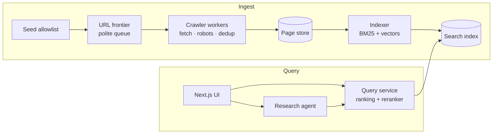

# Architecture

## Overview

## Components
| Component | Job | First version (Week 1) | Later |
|---|---|---|---|
| Seed allowlist | Which sites may be crawled | `seeds.txt` with ~20 sites | Priorities per site |
| URL frontier | What to fetch next, politely | In-memory queue | Priority queue on a real queue (W3) |
| Crawler | Fetch, obey robots.txt, rate limit, dedup | One Bun process | Many workers (W3), near-dup detection (W5) |
| Page store | Raw + cleaned pages | Postgres table | Object storage (W3) |
| Indexer | Make pages searchable | Postgres full-text search | Own BM25 index (W2), vectors (W4), shards (W7) |
| Query service | Rank results | Postgres `ts_rank` | Hybrid ranking (W4), reranker (W6) |
| UI | Search box + results | Next.js page | Research mode UI (W9) |
| Research agent | Plan, read, cite | — | W9–W11 |

## Crawl rules
- Only URLs on allowlisted domains.
- Check and cache `robots.txt` per domain; skip disallowed paths.
- At most 1 request per second per domain (or the site's `Crawl-delay`).
- User-Agent: `ProvenanceBot/0.1 (+<repo URL>)`.
- Normalize URLs and skip ones already seen.

## Crawler modules (`crawler/src/`)
One job per file; `index.ts` only wires them together.

| File | Job | Status |
|---|---|---|
| `config.ts` | Shared settings: User-Agent, fetch timeout, crawl delay | Done (Day 1) |
| `seed.ts` | Load `crawler/seed.txt`; `makeAllowList` → `isAllowed(url)` by hostname | Done (Day 1) |
| `robots.ts` | `fetchRobots`, `parseRobots` (Disallow for `*` / ProvenanceBot), per-host cache, `canFetch(url)` | Done (Day 1) |
| `limiter.ts` | `waitTurn(host)`: at most 1 request per second per host (robots.txt counts) | Done (Day 1) |
| `fetch.ts` | `fetchPage(url)`: timeout, follow redirects, HTML only, `null` on network error | Done (Day 1) |
| `normalize.ts` | One canonical form per URL, so dedup works | Day 2 |
| `frontier.ts` | Queue of URLs to visit + `seen` set + per-domain cap | Day 2 |
| `extract.ts` | HTML → title, text, links | Day 2 |
| `store.ts` | Save pages to Postgres | Day 3 |
| `index.ts` | Main loop | Grows each day |

Main loop: `frontier.next()` → `isAllowed` → `canFetch` → (`waitTurn` inside the fetchers) → `fetchPage` → `extract` → `store` → `frontier.add(links)`.

## Known gaps (fix when they matter)
- `fetchRobots` throws if a site is unreachable, which crashes the crawl (Day 2 warm-up).
- robots.txt: `Allow:` lines, `*` / `$` wildcards (MDN uses `/*/files/`) and `Crawl-delay` are ignored. Ignoring `Allow` is safe (we skip more, never less); wildcards are not.
- Non-HTML content: `text/markdown` is dropped (nextjs.org). HTML meta-refresh redirects are not followed.
- The limiter assumes one loop at a time; parallel workers (Week 3) need a shared design.

## Environments
- **Local (default):** Bun, Docker Compose (Postgres), a local AWS emulator from Week 3.
- **AWS (short demos only):** Terraform, free credits, budget alerts on, no NAT gateways, `terraform destroy` after.

## Open questions
- ~~Folder layout~~: decided, Bun workspaces (`crawler/` now, `web/` on Day 4).
- HTML parser for `extract.ts`: decide on Day 2.
- Embedding model and vector store: decide in Week 4.
