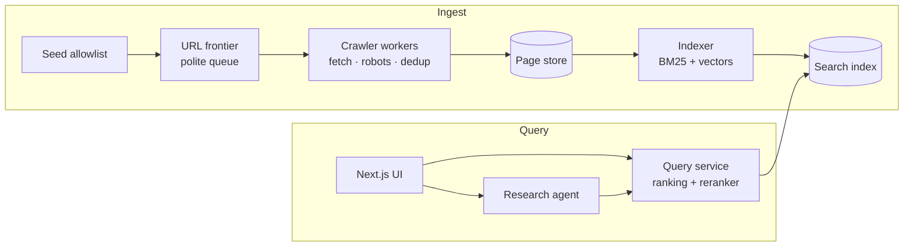

# Architecture

## Overview

## Components
| Component | Job | Now | Later |
|---|---|---|---|
| Seed allowlist | Which sites may be crawled | `crawler/seed.txt` with 20 sites | Priorities per site |
| URL frontier | What to fetch next, politely | In-memory queue | Priority queue on a real message queue |
| Crawler | Fetch, obey robots.txt, rate limit, dedup | One Bun process | Many workers, near-duplicate detection |
| Page store | Raw + cleaned pages | Postgres `pages` + `links` | Object storage for raw pages |
| Indexer | Make pages searchable | Postgres full-text search (`tsvector` + GIN) | Own BM25 index, vectors, shards |
| Query service | Rank results | Postgres `ts_rank` | Hybrid ranking, reranker |
| UI | Search box + results | Next.js search page | Research mode UI |
| Research agent | Plan, read, cite | — | Planned |

## Crawl rules
- Only URLs on allowlisted domains.
- Check and cache `robots.txt` per domain; skip disallowed paths.
- At most 1 request per second per domain (or the site's `Crawl-delay`).
- User-Agent: `ProvenanceBot/0.1 (+<repo URL>)`.
- Normalize URLs and skip ones already seen.

## Crawler modules (`crawler/src/`)
One job per file; `index.ts` only wires them together.

| File | Job | Status |
|---|---|---|
| `config.ts` | Shared settings: User-Agent, fetch timeout, crawl delay, page caps | Done |
| `seed.ts` | Load `crawler/seed.txt`; `makeAllowList` → `isAllowed(url)` by hostname | Done |
| `robots.ts` | `fetchRobots`, `parseRobots` (Disallow for `*` / ProvenanceBot), per-host cache, `canFetch(url)` | Done |
| `limiter.ts` | `waitTurn(host)`: at most 1 request per second per host (robots.txt counts) | Done |
| `fetch.ts` | `fetchPage(url)`: timeout, follow redirects, HTML only, `null` on network error | Done |
| `normalize.ts` | One canonical form per URL, so dedup works | Done |
| `frontier.ts` | Queue of URLs to visit + `seen` set + per-host and total caps | Done |
| `extract.ts` | HTML → title, text, links (Bun's HTMLRewriter) | Done |
| `db.ts` | Postgres connection (Bun `SQL`), fails loudly without `DATABASE_URL` | Done |
| `store.ts` | `savePage`: upsert the page, replace its links, all in one transaction | Done |
| `index.ts` | Main loop | Done |

Main loop: `frontier.next()` → `isAllowed` → `canFetch` → (`waitTurn` inside the fetchers) → `fetchPage` → `extract` → `store` → `frontier.add(links)`.

## Known gaps (fix when they matter)
- robots.txt: `Allow:` lines, `*` / `$` wildcards (MDN uses `/*/files/`) and `Crawl-delay` are ignored. Ignoring `Allow` is safe (we skip more, never less); wildcards are not.
- Non-HTML content: `text/markdown` is dropped (nextjs.org). HTML meta-refresh redirects are not followed.
- The limiter assumes one loop at a time; parallel workers need a shared design.

## Environments
- **Local (default):** Bun, Docker Compose (Postgres); a local AWS emulator once the cloud parts arrive.
- **AWS (short demos only):** Terraform, free credits, budget alerts on, no NAT gateways, `terraform destroy` after.

## Open questions
- Embedding model and vector store: decide with hybrid search.
