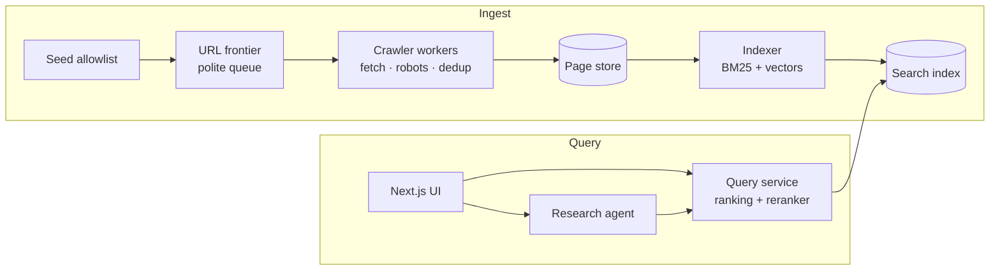

# Architecture

## Overview

## Components
| Component | Job | First version (Week 1) | Later |
|---|---|---|---|
| Seed allowlist | Which sites may be crawled | `seeds.txt` with ~20 sites | Priorities per site |
| URL frontier | What to fetch next, politely | In-memory queue | Priority queue on a real queue (W3) |
| Crawler | Fetch, obey robots.txt, rate limit, dedup | One Bun process | Many workers (W3), near-dup detection (W5) |
| Page store | Raw + cleaned pages | Postgres table | Object storage (W3) |
| Indexer | Make pages searchable | Postgres full-text search | Own BM25 index (W2), vectors (W4), shards (W7) |
| Query service | Rank results | Postgres `ts_rank` | Hybrid ranking (W4), reranker (W6) |
| UI | Search box + results | Next.js page | Research mode UI (W9) |
| Research agent | Plan, read, cite | — | W9–W11 |

## Crawl rules
- Only URLs on allowlisted domains.
- Check and cache `robots.txt` per domain; skip disallowed paths.
- At most 1 request per second per domain (or the site's `Crawl-delay`).
- User-Agent: `ProvenanceBot/0.1 (+<repo URL>)`.
- Normalize URLs and skip ones already seen.

## Environments
- **Local (default):** Bun, Docker Compose (Postgres), a local AWS emulator from Week 3.
- **AWS (short demos only):** Terraform, free credits, budget alerts on, no NAT gateways, `terraform destroy` after.

## Open questions
- Folder layout (single package vs workspaces): decide when setting up the repo.
- Embedding model and vector store: decide in Week 4.
